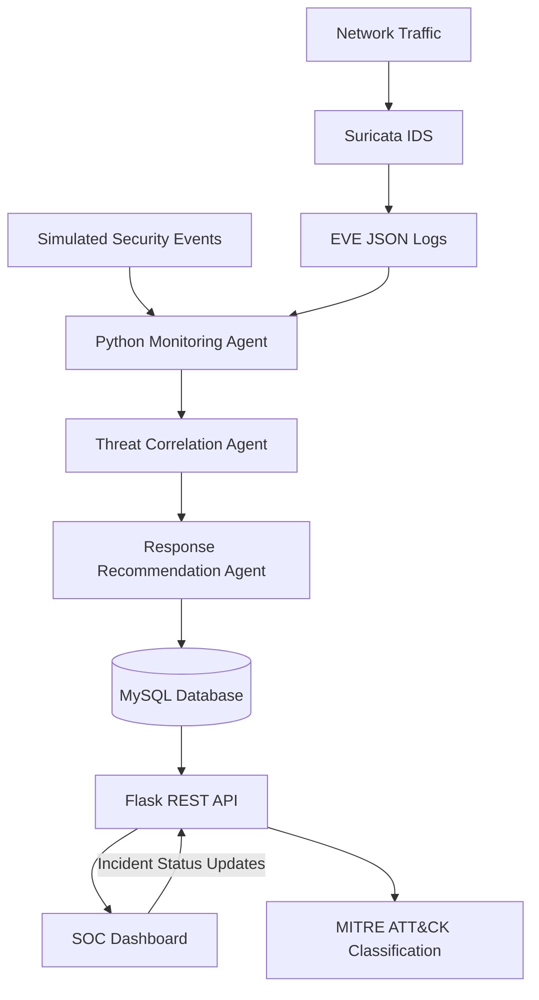

# Sentinel SOC

**A lightweight Security Operations Center (SOC) platform for real-time network intrusion detection, alert correlation, and incident investigation.**

Sentinel SOC is an independent cybersecurity portfolio project that integrates Suricata, Python, MySQL, and Flask into a locally hosted security monitoring platform. It runs natively on Apple Silicon macOS without requiring a virtual machine, cloud services, or external API keys.

## Features

- **Live Intrusion Detection:** Monitors physical network traffic using Suricata and Emerging Threats Open rules.
- **Alert Ingestion:** Processes, validates, and normalizes EVE JSON security alerts.
- **Threat Correlation:** Automatically escalates alert severity based on repeated activity from source IP addresses.
- **Response Recommendations:** Generates investigation priorities and recommended security responses.
- **Persistent Storage:** Stores security alerts and incident information in MySQL.
- **Real-Time Dashboard:** Automatically refreshes security metrics and incoming alerts.
- **Security Analytics:** Displays severity distributions, threat categories, top source IPs, and alert activity timelines.
- **Incident Management:** Supports Open, Investigating, and Resolved incident statuses.
- **Alert Investigation:** Provides detailed network information, severity classifications, and recommended responses.
- **MITRE ATT&CK Integration:** Maps alert signatures to potential attack techniques and tactics using heuristic classification.
- **Advanced Filtering:** Supports searching, severity filtering, status filtering, time ranges, and pagination.
- **CSV Export:** Exports filtered security alerts for reporting and further analysis.
- **Event Source Tracking:** Distinguishes live Suricata alerts from simulated security events.
- **Automated Startup:** Launches the IDS, monitoring agent, and dashboard with a single command.

## System Architecture



## Technologies

| Technology | Purpose |
|---|---|
| Python | Backend development and security automation |
| Suricata | Network intrusion detection |
| Emerging Threats Open | IDS detection rules |
| MySQL | Persistent security event storage |
| Flask | Web application and REST API |
| JavaScript | Dynamic dashboard functionality |
| HTML5 | Dashboard structure |
| CSS3 | Dashboard styling |
| MITRE ATT&CK | Threat classification |
| Bash | Automated startup and shutdown |
| Homebrew | Dependency management |
| Git | Version control |
| macOS | Native development environment |

## Repository Structure

```text
Sentinel-SOC/
├── agents/
│   ├── monitor.py
│   ├── detection.py
│   ├── response.py
│   └── mitre.py
├── collectors/
│   ├── suricata.py
│   ├── snort.py
│   ├── normalize.py
│   └── multi_source.py
├── database/
│   ├── connection.py
│   └── storage.py
├── dashboard/
│   ├── app.py
│   ├── advanced.py
│   ├── templates/
│   │   └── index.html
│   └── static/
│       ├── style.css
│       └── dashboard.js
├── rules/
│   └── local.rules
├── tests/
├── logs/
├── config.py
├── main.py
├── start.sh
├── .env.example
├── .gitignore
└── README.md
```

## Installation

### Prerequisites

- macOS with Homebrew
- Python 3
- MySQL
- Suricata
- Git

The project was developed and tested on Apple Silicon macOS. Other operating systems may require modifications to configuration paths and network interfaces.

### 1. Install Dependencies

```bash
brew install python mysql suricata
brew services start mysql
```

### 2. Configure the Python Environment

From the project directory:

```bash
python3 -m venv .venv
source .venv/bin/activate

pip install flask python-dotenv mysql-connector-python
```

### 3. Configure MySQL

Connect to MySQL using your administrator account:

```bash
mysql -u root -p
```

Create the database and application user:

```sql
CREATE DATABASE IF NOT EXISTS sentinel_soc;

CREATE USER IF NOT EXISTS 'sentinel'@'localhost'
IDENTIFIED BY 'REPLACE_WITH_STRONG_PASSWORD';

GRANT SELECT, INSERT, UPDATE
ON sentinel_soc.*
TO 'sentinel'@'localhost';

USE sentinel_soc;
```

Create the security alerts table:

```sql
CREATE TABLE IF NOT EXISTS alerts (
    id BIGINT AUTO_INCREMENT PRIMARY KEY,
    event_timestamp VARCHAR(64),
    source_ip VARCHAR(45),
    destination_ip VARCHAR(45),
    source_port INT,
    destination_port INT,
    protocol VARCHAR(20),
    signature TEXT,
    category VARCHAR(255),
    original_severity VARCHAR(20),
    severity VARCHAR(20),
    related_alerts INT DEFAULT 1,
    priority VARCHAR(100),
    recommended_response TEXT,
    status VARCHAR(20) DEFAULT 'Open',
    created_at TIMESTAMP DEFAULT CURRENT_TIMESTAMP,
    event_source VARCHAR(32) NOT NULL DEFAULT 'Unknown',
    INDEX idx_source_ip (source_ip),
    INDEX idx_severity (severity),
    INDEX idx_created_at (created_at)
);
```

For existing installations, verify the database schema before applying migrations.

### 4. Configure Environment Variables

Create a `.env` file in the project root:

```env
DB_HOST=127.0.0.1
DB_PORT=3306
DB_USER=sentinel
DB_PASSWORD="REPLACE_WITH_STRONG_PASSWORD"
DB_NAME=sentinel_soc
```

Replace the example password with a strong, unique password.

Never commit `.env` files, database credentials, or captured network logs to GitHub.

### 5. Configure Suricata

Download the Emerging Threats Open ruleset:

```bash
sudo suricata-update
```

Create the logging directory:

```bash
mkdir -p logs/suricata
```

Validate the Suricata configuration:

```bash
sudo suricata -T \
  -c /opt/homebrew/etc/suricata/suricata.yaml \
  -s "$PWD/rules/local.rules" \
  -l "$PWD/logs/suricata"
```

Identify available network interfaces:

```bash
networksetup -listallhardwareports
```

The development environment uses `en0` as its Wi-Fi interface.

## Running Sentinel SOC

Ensure MySQL is running:

```bash
brew services start mysql
```

Make the startup script executable:

```bash
chmod +x start.sh
```

Launch Sentinel SOC:

```bash
./start.sh en0
```

The startup script launches:

1. Python monitoring agent
2. Suricata intrusion detection engine
3. Flask web application
4. Real-time SOC dashboard

Access the dashboard at:

http://127.0.0.1:8080

To stop Sentinel SOC, press `Ctrl+C` in the startup terminal.

Elevated privileges are required for network packet capture.

## SOC Dashboard

The Sentinel SOC dashboard provides centralized visibility into security events and incident activity.

### Security Metrics

- Total security alerts
- Critical severity alerts
- High severity alerts
- Medium severity alerts
- Low severity alerts
- Open security incidents

### Security Analytics

- Alert severity distribution
- Threat category distribution
- Top source IP addresses
- Incident status distribution
- Historical alert activity
- Interactive time-range filtering

### Incident Investigation

Each security alert provides information including:

- Alert ID
- Event timestamp
- Source IP address
- Destination IP address
- Source and destination ports
- Network protocol
- Attack signature
- Event source
- Original severity
- Correlated severity
- Related alert count
- Investigation priority
- Recommended response
- MITRE ATT&CK classification
- Incident status

Missing dashboard values are displayed as `Unknown/Other` where applicable.

## Threat Correlation

Sentinel SOC implements a rule-based threat correlation engine that analyzes repeated security events from individual source IP addresses within a rolling 60-second window.

| Related Alerts | Correlation Behavior |
|---|---|
| 1–4 | Preserve original severity |
| 5–9 | Escalate to High unless already Critical |
| 10+ | Escalate to Critical |

These thresholds are heuristic indicators of potentially suspicious activity and do not independently confirm an attack.

## Automated Response Recommendations

The response agent assigns investigation priorities based on alert severity.

| Severity | Investigation Priority |
|---|---|
| Critical | Immediate investigation |
| High | Urgent investigation |
| Medium | Scheduled investigation |
| Low | Continue monitoring |
| Unknown | Manual review |

The response agent provides recommendations for security events such as:

- Brute-force attempts
- SYN floods
- Network reconnaissance
- Port scanning
- Suspicious DNS activity
- Suspicious HTTPS activity
- Other potentially malicious network activity

Response recommendations assist security analysts rather than automatically blocking network traffic.

## MITRE ATT&CK Integration

Sentinel SOC uses signature-based heuristics to associate security alerts with potential MITRE ATT&CK techniques.

| Security Event | Technique ID | Technique |
|---|---|---|
| Brute Force | T1110 | Brute Force |
| Port Scanning | T1046 | Network Service Discovery |
| Network Flooding | T1498 | Network Denial of Service |
| ARP Spoofing | T1557.002 | ARP Cache Poisoning |
| DNS Tunneling | T1071.004 | DNS |
| SQL Injection | T1190 | Exploit Public-Facing Application |

MITRE ATT&CK classifications are heuristic mappings and require analyst verification.

## Event Source Classification

Sentinel SOC distinguishes between different alert sources.

| Event Source | Description |
|---|---|
| Live - Suricata | Alerts generated through live network monitoring |
| Simulated | Synthetic security events generated for testing |
| Unknown | Events without verified source information |

This distinction allows analysts to differentiate controlled testing from observed network activity.

## Detection Rule Tuning

Sentinel SOC integrates Emerging Threats Open detection rules alongside custom Suricata rules.

During development, the updated ruleset contained:

- 69,581 total detection rules
- 53,603 enabled detection rules

The Suricata decoder rule `2200121`, associated with unknown Ethernet protocol types, was disabled after generating excessive alert noise.

Historical matching alerts were marked as resolved rather than deleted to preserve security event records.

Disabling this rule reduces visibility into unknown Ethernet protocol types and should be evaluated before deployment in other environments.

## Testing and Validation

Sentinel SOC has been tested using simulated security events and live network traffic.

| Test | Result |
|---|---|
| Suricata configuration validation | Passed |
| Live loopback ICMP detection | Passed |
| Physical Wi-Fi packet capture | Passed |
| EVE JSON alert ingestion | Passed |
| Malformed JSON handling | Passed |
| Missing alert field handling | Passed |
| Partial JSON line handling | Passed |
| Simulated alert burst processing | Passed |
| Threat severity escalation | Passed |
| MySQL alert persistence | Passed |
| Database connectivity | Passed |
| Dashboard automatic refresh | Passed |
| MITRE ATT&CK classification | Passed for tested signatures |
| CSV export | Passed |
| Single-command startup | Passed |
| Flask HTTP connectivity | Passed |

During one physical network capture session, Suricata reported:

- 14,574 captured packets
- 0 dropped packets
- 0 invalid checksums

These results represent development testing rather than formal performance benchmarks.

## Security Considerations

- Database credentials are stored in environment variables.
- Database queries use parameterized SQL statements.
- The application uses a dedicated MySQL account with restricted permissions.
- The dashboard binds to localhost by default.
- Sensitive logs and credentials are excluded from version control.
- CSV exports include basic spreadsheet formula injection protection.
- Network monitoring should only be performed on authorized systems and networks.

## Future Improvements

- [ ] Expand automated unit and integration testing
- [ ] Implement role-based access control
- [ ] Improve dashboard authentication
- [ ] Add dedicated event source filtering
- [ ] Improve threat correlation across multiple signatures
- [ ] Implement persistent incident grouping
- [ ] Add database connection pooling
- [ ] Implement database retry mechanisms
- [ ] Add persistent log ingestion checkpoints
- [ ] Implement log rotation handling
- [ ] Improve automated shutdown and stale-lock recovery
- [ ] Expand MITRE ATT&CK classifications
- [ ] Add additional IDS integrations
- [ ] Implement automated incident reporting
- [ ] Conduct formal performance benchmarking
- [ ] Expand deployment compatibility

## Project Objectives

Sentinel SOC was developed to demonstrate practical experience in:

- Security Operations Center workflows
- Network intrusion detection
- Network traffic analysis
- Security event correlation
- Incident investigation
- Threat classification
- Security automation
- Database management
- REST API development
- Full-stack application development
- Linux and Unix-based systems
- Secure software development

## Disclaimer

Sentinel SOC is an independent educational and cybersecurity portfolio project. It is not intended to replace an enterprise SIEM, commercial intrusion detection platform, or professionally managed Security Operations Center.

Detected security events represent IDS rule matches and do not necessarily indicate confirmed malicious activity.

Only use this software on networks and systems that you own or have explicit authorization to monitor.

## Author

**Theo Cseledy**

Cybersecurity Student | Miami University

Independent cybersecurity portfolio project focused on network security, intrusion detection, security automation, and Security Operations Center development.
