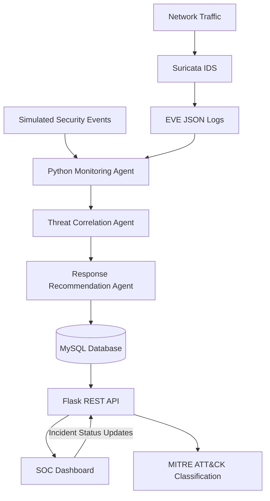

# Sentinel SOC

**A lightweight Security Operations Center (SOC) platform for real-time network intrusion detection, alert correlation, and incident investigation.**

Sentinel SOC is an independent cybersecurity portfolio project that integrates Suricata, Python, MySQL, and Flask into a locally hosted security monitoring platform. It runs natively on Apple Silicon macOS without requiring a virtual machine, cloud services, or external API keys.

## Features

- **Live Intrusion Detection:** Monitors physical network traffic using Suricata and Emerging Threats Open rules.
- **Alert Ingestion:** Processes, validates, and normalizes EVE JSON security alerts.
- **Threat Correlation:** Automatically escalates alert severity based on repeated activity from source IP addresses.
- **Response Recommendations:** Generates investigation priorities and recommended security responses.
- **Persistent Storage:** Stores security alerts and incident information in MySQL.
- **Real-Time Dashboard:** Automatically refreshes security metrics and incoming alerts.
- **Security Analytics:** Displays severity distributions, threat categories, top source IPs, and alert activity timelines.
- **Incident Management:** Supports Open, Investigating, and Resolved incident statuses.
- **Alert Investigation:** Provides detailed network information, severity classifications, and recommended responses.
- **MITRE ATT&CK Integration:** Maps alert signatures to potential attack techniques and tactics using heuristic classification.
- **Advanced Filtering:** Supports searching, severity filtering, status filtering, time ranges, and pagination.
- **CSV Export:** Exports filtered security alerts for reporting and further analysis.
- **Event Source Tracking:** Distinguishes live Suricata alerts from simulated security events.
- **Automated Startup:** Launches the IDS, monitoring agent, and dashboard with a single command.

## System Architecture



## Technologies

| Technology | Purpose |
|---|---|
| Python | Backend development and security automation |
| Suricata | Network intrusion detection |
| Emerging Threats Open | IDS detection rules |
| MySQL | Persistent security event storage |
| Flask | Web application and REST API |
| JavaScript | Dynamic dashboard functionality |
| HTML5 | Dashboard structure |
| CSS3 | Dashboard styling |
| MITRE ATT&CK | Threat classification |
| Bash | Automated startup and shutdown |
| Homebrew | Dependency management |
| Git | Version control |
| macOS | Native development environment |

## Repository Structure

```text
Sentinel-SOC/
├── agents/
│   ├── monitor.py
│   ├── detection.py
│   ├── response.py
│   └── mitre.py
├── collectors/
│   ├── suricata.py
│   ├── snort.py
│   ├── normalize.py
│   └── multi_source.py
├── database/
│   ├── connection.py
│   └── storage.py
├── dashboard/
│   ├── app.py
│   ├── advanced.py
│   ├── templates/
│   │   └── index.html
│   └── static/
│       ├── style.css
│       └── dashboard.js
├── rules/
│   └── local.rules
├── tests/
├── logs/
├── config.py
├── main.py
├── start.sh
├── .env.example
├── .gitignore
└── README.md
```

## Installation

### Prerequisites

- macOS with Homebrew
- Python 3
- MySQL
- Suricata
- Git

The project was developed and tested on Apple Silicon macOS. Other operating systems may require modifications to configuration paths and network interfaces.

## Installation and Configuration

### 1. Clone the Repository

```bash
git clone https://github.com/tcseledy/Sentinel-SOC.git
cd Sentinel-SOC
```

### 2. Install Dependencies

Sentinel SOC was developed for Apple Silicon macOS using Homebrew.

```bash
brew install python mysql suricata
brew services start mysql
```

### 3. Configure the Python Environment

From the project directory:

```bash
python3 -m venv .venv
source .venv/bin/activate

pip install flask python-dotenv mysql-connector-python
```

### 4. Configure MySQL

Connect to MySQL using an administrator account:

```bash
mysql -u root -p
```

Create the database and application user:

```sql
CREATE DATABASE IF NOT EXISTS sentinel_soc;

CREATE USER IF NOT EXISTS 'sentinel'@'localhost'
IDENTIFIED BY 'REPLACE_WITH_STRONG_PASSWORD';

GRANT SELECT, INSERT, UPDATE
ON sentinel_soc.*
TO 'sentinel'@'localhost';

USE sentinel_soc;
```

Create the security alerts table:

```sql
CREATE TABLE IF NOT EXISTS alerts (
    id BIGINT AUTO_INCREMENT PRIMARY KEY,
    event_timestamp VARCHAR(64),
    source_ip VARCHAR(45),
    destination_ip VARCHAR(45),
    source_port INT,
    destination_port INT,
    protocol VARCHAR(20),
    signature TEXT,
    category VARCHAR(255),
    original_severity VARCHAR(20),
    severity VARCHAR(20),
    related_alerts INT DEFAULT 1,
    priority VARCHAR(100),
    recommended_response TEXT,
    status VARCHAR(20) DEFAULT 'Open',
    created_at TIMESTAMP DEFAULT CURRENT_TIMESTAMP,
    event_source VARCHAR(32) NOT NULL DEFAULT 'Unknown',
    INDEX idx_source_ip (source_ip),
    INDEX idx_severity (severity),
    INDEX idx_created_at (created_at)
);
```

Exit MySQL:

```sql
EXIT;
```

For existing installations, verify the database schema before applying migrations.

### 5. Configure Environment Variables

Create a `.env` file in the project root:

```bash
nano .env
```

Add the following configuration:

```env
DB_HOST=127.0.0.1
DB_PORT=3306
DB_USER=sentinel
DB_PASSWORD="REPLACE_WITH_STRONG_PASSWORD"
DB_NAME=sentinel_soc
```

Replace the example password with the password configured in MySQL.

Never commit `.env` files, database credentials, or captured network logs to GitHub.

### 6. Verify Database Connectivity

```bash
source .venv/bin/activate

python -c 'from database.connection import get_connection; c = get_connection(); print("Database connected"); c.close()'
```

Expected output:

```text
Database connected
```

### 7. Configure Suricata

Download the Emerging Threats Open ruleset:

```bash
sudo suricata-update
```

Create the logging directory:

```bash
mkdir -p logs/suricata
```

Verify that the custom detection rules exist:

```bash
cat rules/local.rules
```

Validate the Suricata configuration:

```bash
sudo suricata -T \
  -c /opt/homebrew/etc/suricata/suricata.yaml \
  -s "$PWD/rules/local.rules" \
  -l "$PWD/logs/suricata"
```

Expected output:

```text
Configuration provided was successfully loaded. Exiting.
```

Identify available network interfaces:

```bash
networksetup -listallhardwareports
```

The development environment uses `en0` as its physical Wi-Fi interface.

Verify that the interface is active:

```bash
ifconfig en0 | grep status
```

## Running Sentinel SOC

### 1. Start the Platform

Ensure MySQL is running:

```bash
brew services start mysql
```

Make the startup script executable:

```bash
chmod +x start.sh
```

Launch Sentinel SOC:

```bash
./start.sh en0
```

The startup script automatically:

1. Activates the Python virtual environment.
2. Verifies MySQL connectivity.
3. Checks for existing processes and startup locks.
4. Checks whether port 8080 is available.
5. Requests elevated privileges for packet capture.
6. Creates a dedicated logging directory.
7. Starts the Python monitoring agent.
8. Starts Suricata IDS.
9. Starts the Flask web application.
10. Verifies dashboard connectivity.
11. Opens the SOC dashboard.

### 2. Access the Dashboard

Open the following address in a web browser:

http://127.0.0.1:8080

Alternatively:

```bash
open http://127.0.0.1:8080
```

The dashboard automatically refreshes approximately every five seconds.

### 3. Stop Sentinel SOC

Press `Ctrl+C` in the terminal running the startup script.

The startup script is designed to terminate the monitoring agent, Suricata, and Flask dashboard.

### 4. Restart Sentinel SOC

After confirming the previous instance has stopped:

```bash
./start.sh en0
```

## Using Individual Tools

The individual components can also be operated independently for development, testing, and troubleshooting.

Do not start duplicate Suricata or Flask processes while the automated startup script is running.

### 1. Suricata IDS

Suricata captures network traffic and inspects packets against enabled detection rules.

Check the installed version:

```bash
suricata --build-info
```

Update detection rules:

```bash
sudo suricata-update
```

Manually start network monitoring:

```bash
sudo suricata \
  -c /opt/homebrew/etc/suricata/suricata.yaml \
  -i en0 \
  -s "$PWD/rules/local.rules" \
  -l "$PWD/logs/suricata"
```

View raw network events in another terminal:

```bash
tail -f logs/suricata/eve.json
```

View only security alert entries:

```bash
grep '"event_type":"alert"' logs/suricata/eve.json
```

Stop Suricata using `Ctrl+C`.

### 2. Python Alert Collector

Activate the Python environment:

```bash
source .venv/bin/activate
```

Display available command-line arguments:

```bash
python main.py --help
```

Analyze an existing Suricata log file:

```bash
python main.py --log logs/suricata/eve.json
```

This processes existing alert entries and displays their normalized information.

Start continuous alert monitoring:

```bash
SOC_EVENT_SOURCE="Live - Suricata" \
python main.py --live --log logs/suricata/eve.json
```

The live monitoring agent automatically:

- Reads incoming EVE JSON alerts.
- Validates JSON formatting.
- Extracts security event information.
- Classifies original alert severity.
- Correlates repeated security events.
- Generates response recommendations.
- Stores processed alerts in MySQL.

The live monitor processes newly appended entries rather than replaying existing entries.

### 3. MySQL Database

Connect to the Sentinel SOC database:

```bash
mysql -h 127.0.0.1 -u sentinel -p sentinel_soc
```

Display available tables:

```sql
SHOW TABLES;
```

Display the alerts table structure:

```sql
DESCRIBE alerts;
```

Display the latest 10 security alerts:

```sql
SELECT *
FROM alerts
ORDER BY id DESC
LIMIT 10;
```

Display alert counts by severity:

```sql
SELECT severity, COUNT(*) AS total
FROM alerts
GROUP BY severity;
```

Display critical security alerts:

```sql
SELECT id, source_ip, signature, severity
FROM alerts
WHERE severity = 'Critical';
```

Display live and simulated alert counts:

```sql
SELECT event_source, COUNT(*) AS total
FROM alerts
GROUP BY event_source;
```

Display open incidents:

```sql
SELECT id, signature, severity, status
FROM alerts
WHERE status = 'Open';
```

Display the most frequently observed source IP addresses:

```sql
SELECT
    COALESCE(source_ip, 'Unknown/Other') AS source,
    COUNT(*) AS total
FROM alerts
GROUP BY source
ORDER BY total DESC
LIMIT 10;
```

Display the most frequently observed attack signatures:

```sql
SELECT signature, COUNT(*) AS total
FROM alerts
GROUP BY signature
ORDER BY total DESC
LIMIT 10;
```

Display incident status statistics:

```sql
SELECT status, COUNT(*) AS total
FROM alerts
GROUP BY status;
```

Exit MySQL:

```sql
EXIT;
```

### 4. Flask Web Application

Launch only the dashboard without starting Suricata:

```bash
source .venv/bin/activate

python -m flask --app dashboard.app run \
  --host 127.0.0.1 \
  --port 8080
```

Open the dashboard:

```bash
open http://127.0.0.1:8080
```

The dashboard can display previously stored security alerts even when live network monitoring is not running.

Stop Flask using `Ctrl+C`.

## Using the SOC Dashboard

### 1. Security Metrics

The dashboard displays:

- Total security alerts
- Critical severity alerts
- High severity alerts
- Medium severity alerts
- Low severity alerts
- Open security incidents

### 2. Security Analytics

The analytics panels provide:

- Alert severity distribution
- Threat category distribution
- Top source IP addresses
- Incident status distribution
- Alert activity timeline

The timeline supports multiple time ranges, including:

- Last hour
- Last 24 hours
- Last 7 days
- Last 30 days

### 3. Search and Filter Alerts

Use the search bar to locate alerts by:

- Alert ID
- Source IP address
- Destination IP address
- Attack signature

Use the severity filter to display:

- Critical
- High
- Medium
- Low
- Unknown

Use the status filter to display:

- Open
- Investigating
- Resolved

Use the global time-range filter to narrow the displayed security events.

Pagination allows users to display 15, 30, 50, or 100 alerts per page.

### 4. Investigate Security Alerts

Click an alert ID or attack type to open the investigation panel.

The investigation panel displays available information including:

- Network information
- Attack signature
- Event timestamp
- Original severity
- Correlated severity
- Related alert count
- Investigation priority
- Recommended response
- MITRE ATT&CK classification
- Incident status

Missing dashboard values are displayed as `Unknown/Other` where applicable.

### 5. Manage Security Incidents

Each alert can be assigned one of three statuses:

| Status | Description |
|---|---|
| Open | Alert awaiting investigation |
| Investigating | Alert currently being analyzed |
| Resolved | Investigation completed or disposition determined |

Change the status using the dropdown in the alert table or investigation panel.

Status changes are automatically saved in MySQL.

### 6. Export Security Reports

Click the Export CSV button to download security alerts.

The export includes the currently applied search, severity, status, and time-range filters.

CSV reports can be opened using spreadsheet applications for additional analysis and reporting.

## Testing Sentinel SOC

### 1. Test Live Network Detection

Stop any existing Sentinel SOC instance.

Start Sentinel SOC on the loopback interface:

```bash
./start.sh lo0
```

Wait until Suricata and the monitoring agent have started.

Open a separate terminal and generate local ICMP traffic:

```bash
ping -c 3 127.0.0.1
```

The custom Suricata detection rule should generate alerts containing the signature:

```text
Sentinel SOC Live ICMP Detection
```

Verify that the alerts appear in the dashboard with the event source:

```text
Live - Suricata
```

This test validates the complete pipeline:

```text
ICMP Traffic
    -> Suricata IDS
    -> EVE JSON
    -> Python Monitoring Agent
    -> Threat Correlation
    -> Response Recommendation
    -> MySQL
    -> Flask Dashboard
```

### 2. Test Physical Network Monitoring

Stop the loopback monitoring session.

Start Sentinel SOC on the physical network interface:

```bash
./start.sh en0
```

Use the computer normally to generate network traffic.

Suricata continuously inspects captured network traffic and generates alerts when activity matches an enabled detection rule.

Normal network activity may not generate security alerts.

### 3. Generate Simulated Security Alerts

Simulated alerts allow users to test the security monitoring pipeline without performing actual network attacks.

Create a simulated log file:

```bash
mkdir -p logs
touch logs/simulated.json
```

Start the monitoring agent in a separate terminal:

```bash
source .venv/bin/activate

SOC_EVENT_SOURCE="Simulated" \
python main.py --live --log logs/simulated.json
```

Open another terminal and generate a simulated security alert:

```bash
python3 - <<'PY'
import json
from datetime import datetime

event = {
    "timestamp": datetime.now().isoformat(),
    "event_type": "alert",
    "src_ip": "10.0.0.50",
    "dest_ip": "10.0.0.2",
    "src_port": 49152,
    "dest_port": 22,
    "proto": "TCP",
    "alert": {
        "signature": "SSH Brute Force Test",
        "category": "Attempted Administrator Privilege Gain",
        "severity": 3
    }
}

with open("logs/simulated.json", "a") as file:
    file.write(json.dumps(event) + "\n")

print("Simulated alert generated.")
PY
```

The simulated event should appear in the dashboard with the event source:

```text
Simulated
```

Ensure the Flask dashboard is running to view the results.

### 4. Test Threat Correlation

Restart the simulated monitoring agent to reset its in-memory correlation history.

Generate 12 simulated security alerts from the same source IP:

```bash
python3 - <<'PY'
import json
from datetime import datetime

with open("logs/simulated.json", "a") as file:
    for i in range(12):
        event = {
            "timestamp": datetime.now().isoformat(),
            "event_type": "alert",
            "src_ip": "10.0.0.50",
            "dest_ip": "10.0.0.2",
            "src_port": 49152 + i,
            "dest_port": 22,
            "proto": "TCP",
            "alert": {
                "signature": "SSH Brute Force Test",
                "category": "Attempted Administrator Privilege Gain",
                "severity": 3
            }
        }

        file.write(json.dumps(event) + "\n")

print("Generated 12 simulated security alerts.")
PY
```

Expected severity progression when processed within 60 seconds:

| Alert Number | Original Severity | Correlated Severity |
|---|---|---|
| 1–4 | Low | Low |
| 5–9 | Low | High |
| 10–12 | Low | Critical |

These commands generate synthetic log entries only and do not perform network attacks.

### 5. Test MITRE ATT&CK Classification

Activate the Python environment:

```bash
source .venv/bin/activate
```

Run the classification module:

```bash
python - <<'PY'
from agents.mitre import classify_mitre

signatures = [
    "SSH Brute Force",
    "Port Scan",
    "SYN Flood",
    "ARP Spoofing",
    "DNS Tunneling",
    "SQL Injection",
    "Unknown Activity"
]

for signature in signatures:
    print(signature)
    print(classify_mitre(signature))
    print()
PY
```

The module returns potential MITRE ATT&CK technique IDs, technique names, tactics, confidence levels, and reference URLs.

Unrecognized signatures are classified as Unclassified.

### 6. Test Response Recommendations

```bash
python - <<'PY'
from agents.response import recommend_response

tests = [
    ("SSH Brute Force", "Critical"),
    ("SYN Flood", "High"),
    ("Port Scan", "Medium"),
    ("Suspicious DNS", "Low"),
    ("Unknown Activity", "Unknown")
]

for signature, severity in tests:
    print(signature, severity)
    print(recommend_response(signature, severity))
    print()
PY
```

The response agent returns an investigation priority and recommended security response.

## Using the REST API

The Flask application exposes REST API endpoints for retrieving security information, managing incidents, and exporting reports.

### 1. Retrieve Dashboard Metrics

```bash
curl http://127.0.0.1:8080/api/alerts
```

### 2. Retrieve Filtered Alerts

```bash
curl "http://127.0.0.1:8080/api/advanced/alerts?severity=Critical"
```

### 3. Retrieve Open Incidents

```bash
curl "http://127.0.0.1:8080/api/advanced/alerts?status=Open"
```

### 4. Retrieve Recent Alerts

```bash
curl "http://127.0.0.1:8080/api/advanced/alerts?range=24h"
```

### 5. Search Security Alerts

```bash
curl "http://127.0.0.1:8080/api/advanced/alerts?search=10.0.0.50"
```

### 6. Retrieve Paginated Alerts

```bash
curl "http://127.0.0.1:8080/api/advanced/alerts?page=1&limit=30"
```

### 7. Retrieve an Individual Alert

```bash
curl http://127.0.0.1:8080/api/alerts/1
```

### 8. Retrieve Related Alerts

```bash
curl http://127.0.0.1:8080/api/alerts/1/related
```

### 9. Retrieve MITRE ATT&CK Classification

```bash
curl http://127.0.0.1:8080/api/alerts/1/mitre
```

### 10. Retrieve Alert Activity Timeline

```bash
curl "http://127.0.0.1:8080/api/alerts/timeline?range=24h"
```

### 11. Update Incident Status

```bash
curl -X PATCH \
  http://127.0.0.1:8080/api/alerts/1/status \
  -H "Content-Type: application/json" \
  -d '{"status":"Investigating"}'
```

Resolve an incident:

```bash
curl -X PATCH \
  http://127.0.0.1:8080/api/alerts/1/status \
  -H "Content-Type: application/json" \
  -d '{"status":"Resolved"}'
```

Replace `1` with an existing alert ID.

### 12. Export Security Alerts

Export all alerts:

```bash
curl http://127.0.0.1:8080/api/alerts/export \
  -o sentinel-alerts.csv
```

Export critical alerts:

```bash
curl "http://127.0.0.1:8080/api/alerts/export?severity=Critical" \
  -o critical-alerts.csv
```

Export open incidents:

```bash
curl "http://127.0.0.1:8080/api/alerts/export?status=Open" \
  -o open-incidents.csv
```

Open the exported report:

```bash
open sentinel-alerts.csv
```

Exported reports may contain sensitive network information and should not be committed to a public repository.

## Detection Rule Management

### 1. Update Detection Rules

Stop Sentinel SOC before updating the ruleset.

```bash
sudo suricata-update
```

### 2. Inspect the Installed Ruleset

```bash
ls -lh /opt/homebrew/var/lib/suricata/rules/
```

Search for a specific detection rule:

```bash
grep -F 'sid:2200121;' \
  /opt/homebrew/var/lib/suricata/rules/suricata.rules
```

### 3. Reduce Excessive Alert Noise

During development, Suricata rule `2200121` generated excessive unknown Ethernet protocol alerts.

To reproduce the development environment's rule tuning:

```bash
sudo mkdir -p /opt/homebrew/etc/suricata

sudo touch /opt/homebrew/etc/suricata/disable.conf

grep -qxF '2200121' /opt/homebrew/etc/suricata/disable.conf || \
echo '2200121' | sudo tee -a /opt/homebrew/etc/suricata/disable.conf
```

Update the ruleset using the custom disable configuration:

```bash
sudo suricata-update \
  --disable-conf /opt/homebrew/etc/suricata/disable.conf
```

Verify the rule is disabled:

```bash
grep -F 'sid:2200121;' \
  /opt/homebrew/var/lib/suricata/rules/suricata.rules
```

A disabled rule should be commented out or absent.

Validate the updated configuration:

```bash
sudo suricata -T \
  -c /opt/homebrew/etc/suricata/suricata.yaml \
  -s "$PWD/rules/local.rules" \
  -l "$PWD/logs/suricata"
```

Restart Sentinel SOC:

```bash
./start.sh en0
```

Disabling this rule reduces visibility into unknown Ethernet protocol types. Rule tuning should be evaluated for each monitoring environment.

## System Health Verification

### 1. Verify the Startup Script

```bash
pgrep -fl 'start.sh'
```

### 2. Verify Suricata

```bash
pgrep -x suricata
```

### 3. Verify the Python Monitoring Agent

```bash
pgrep -fl 'main.py'
```

### 4. Verify Flask Connectivity

```bash
curl -I http://127.0.0.1:8080
```

Expected response:

```text
HTTP/1.1 200 OK
```

### 5. Verify MySQL

```bash
brew services list
```

### 6. Inspect Active Logging Directories

```bash
ls -ldt logs/live.*
```

The automated startup script creates a separate logging directory for each monitoring session.

To inspect the latest session's EVE JSON log:

```bash
LATEST_LOG=$(ls -dt logs/live.* | head -n 1)
tail -f "$LATEST_LOG/eve.json"
```

## Troubleshooting

### Dashboard Port Already Occupied

Identify the process using port 8080:

```bash
lsof -nP -iTCP:8080 -sTCP:LISTEN
```

Stop the existing dashboard or Sentinel SOC instance before restarting.

### Startup Lock Exists

Check whether Sentinel SOC is already running:

```bash
pgrep -fl 'start.sh'
pgrep -fl suricata
pgrep -fl 'main.py'
lsof -nP -iTCP:8080 -sTCP:LISTEN
```

If Sentinel SOC is running, stop the original startup script.

Only after confirming that all Sentinel SOC processes have stopped, remove the stale startup lock:

```bash
rmdir logs/.sentinel-running
```

Restart Sentinel SOC:

```bash
./start.sh en0
```

### Suricata Already Running

Identify the running Suricata processes:

```bash
pgrep -fl suricata
```

Stop the existing Sentinel SOC instance before starting another.

### Database Connection Failure

Verify that MySQL is running:

```bash
brew services start mysql
```

Activate the Python environment:

```bash
source .venv/bin/activate
```

Test database connectivity:

```bash
python -c 'from database.connection import get_connection; c = get_connection(); print("Database connected"); c.close()'
```

Verify that the credentials in `.env` match the MySQL application user.

### Python Dependency Errors

Activate the virtual environment and reinstall dependencies:

```bash
source .venv/bin/activate
pip install flask python-dotenv mysql-connector-python
```

### Permission Denied

Suricata requires elevated privileges for network packet capture.

Refresh administrator authentication:

```bash
sudo -v
```

Restart Sentinel SOC:

```bash
./start.sh en0
```

### Dashboard Changes Not Appearing

Perform a hard browser refresh:

```text
Command + Shift + R
```

### No Security Alerts Appearing

Verify that:

1. Suricata is running.
2. The selected network interface is active.
3. The Python monitoring agent is running.
4. The EVE JSON log is receiving events.
5. MySQL is connected.
6. The Flask dashboard is running.

Use the controlled loopback ICMP test to verify the complete detection pipeline.

Normal network traffic does not necessarily trigger security alerts.

## Operational and Security Notes

- MySQL must be running before Sentinel SOC is launched.
- Only one automated Sentinel SOC instance should run at a time.
- Network interface names may differ between computers.
- The dashboard is hosted locally on port 8080.
- No external API keys are required.
- No virtual machine is required.
- Snort and Wazuh are not required for the primary Suricata-based monitoring pipeline.
- Database credentials and network logs must remain outside version control.
- MITRE ATT&CK classifications are heuristic and require analyst verification.
- Threat correlation is based on repeated alert activity rather than confirmed malicious behavior.
- Response recommendations do not automatically block network traffic.
- Only monitor networks and systems that you own or have explicit authorization to monitor.
- Sentinel SOC is an educational cybersecurity portfolio project and is not intended to replace an enterprise SOC or SIEM platform.

### Security Metrics

- Total security alerts
- Critical severity alerts
- High severity alerts
- Medium severity alerts
- Low severity alerts
- Open security incidents

### Security Analytics

- Alert severity distribution
- Threat category distribution
- Top source IP addresses
- Incident status distribution
- Historical alert activity
- Interactive time-range filtering

### Incident Investigation

Each security alert provides information including:

- Alert ID
- Event timestamp
- Source IP address
- Destination IP address
- Source and destination ports
- Network protocol
- Attack signature
- Event source
- Original severity
- Correlated severity
- Related alert count
- Investigation priority
- Recommended response
- MITRE ATT&CK classification
- Incident status

Missing dashboard values are displayed as `Unknown/Other` where applicable.

## Threat Correlation

Sentinel SOC implements a rule-based threat correlation engine that analyzes repeated security events from individual source IP addresses within a rolling 60-second window.

| Related Alerts | Correlation Behavior |
|---|---|
| 1–4 | Preserve original severity |
| 5–9 | Escalate to High unless already Critical |
| 10+ | Escalate to Critical |

These thresholds are heuristic indicators of potentially suspicious activity and do not independently confirm an attack.

## Automated Response Recommendations

The response agent assigns investigation priorities based on alert severity.

| Severity | Investigation Priority |
|---|---|
| Critical | Immediate investigation |
| High | Urgent investigation |
| Medium | Scheduled investigation |
| Low | Continue monitoring |
| Unknown | Manual review |

The response agent provides recommendations for security events such as:

- Brute-force attempts
- SYN floods
- Network reconnaissance
- Port scanning
- Suspicious DNS activity
- Suspicious HTTPS activity
- Other potentially malicious network activity

Response recommendations assist security analysts rather than automatically blocking network traffic.

## MITRE ATT&CK Integration

Sentinel SOC uses signature-based heuristics to associate security alerts with potential MITRE ATT&CK techniques.

| Security Event | Technique ID | Technique |
|---|---|---|
| Brute Force | T1110 | Brute Force |
| Port Scanning | T1046 | Network Service Discovery |
| Network Flooding | T1498 | Network Denial of Service |
| ARP Spoofing | T1557.002 | ARP Cache Poisoning |
| DNS Tunneling | T1071.004 | DNS |
| SQL Injection | T1190 | Exploit Public-Facing Application |

MITRE ATT&CK classifications are heuristic mappings and require analyst verification.

## Event Source Classification

Sentinel SOC distinguishes between different alert sources.

| Event Source | Description |
|---|---|
| Live - Suricata | Alerts generated through live network monitoring |
| Simulated | Synthetic security events generated for testing |
| Unknown | Events without verified source information |

This distinction allows analysts to differentiate controlled testing from observed network activity.

## Detection Rule Tuning

Sentinel SOC integrates Emerging Threats Open detection rules alongside custom Suricata rules.

During development, the updated ruleset contained:

- 69,581 total detection rules
- 53,603 enabled detection rules

The Suricata decoder rule `2200121`, associated with unknown Ethernet protocol types, was disabled after generating excessive alert noise.

Historical matching alerts were marked as resolved rather than deleted to preserve security event records.

Disabling this rule reduces visibility into unknown Ethernet protocol types and should be evaluated before deployment in other environments.

During one physical network capture session, Suricata reported:

- 14,574 captured packets
- 0 dropped packets
- 0 invalid checksums

These results represent development testing rather than formal performance benchmarks.

## Security Considerations

- Database credentials are stored in environment variables.
- Database queries use parameterized SQL statements.
- The application uses a dedicated MySQL account with restricted permissions.
- The dashboard binds to localhost by default.
- Sensitive logs and credentials are excluded from version control.
- CSV exports include basic spreadsheet formula injection protection.
- Network monitoring should only be performed on authorized systems and networks.

## Project Objectives

Sentinel SOC was developed to demonstrate practical experience in:

- Security Operations Center workflows
- Network intrusion detection
- Network traffic analysis
- Security event correlation
- Incident investigation
- Threat classification
- Security automation
- Database management
- REST API development
- Full-stack application development
- Linux and Unix-based systems
- Secure software development

## Disclaimer

Sentinel SOC is an independent educational and cybersecurity portfolio project. It is not intended to replace an enterprise SIEM, commercial intrusion detection platform, or professionally managed Security Operations Center.

Detected security events represent IDS rule matches and do not necessarily indicate confirmed malicious activity.

Only use this software on networks and systems that you own or have explicit authorization to monitor.

## Author

**Theo Cseledy**

Cybersecurity Student | Miami University

Independent cybersecurity portfolio project focused on network security, intrusion detection, security automation, and Security Operations Center development.
